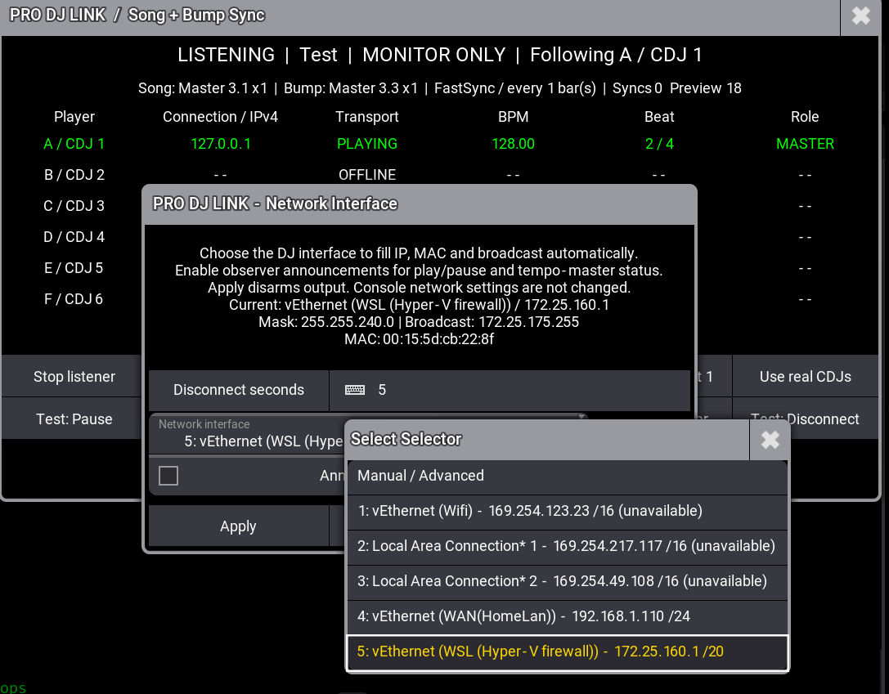
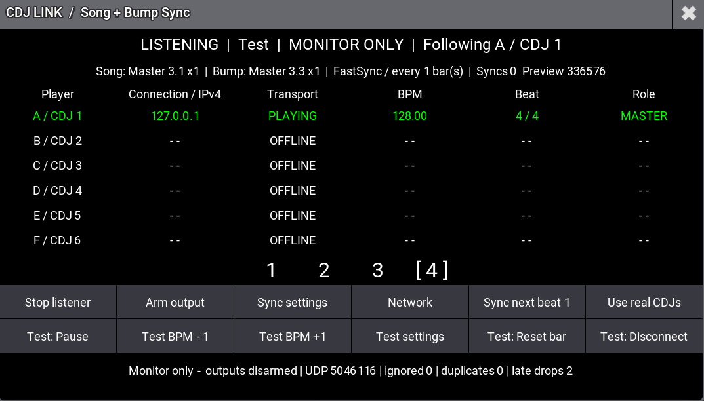

# grandMA3 PRO DJ LINK

[](https://github.com/Anon772000/grandma3-PRO-DJ-LINK/releases/latest)
[](https://github.com/Anon772000/grandma3-PRO-DJ-LINK/actions/workflows/validate.yml)
[](LICENSE)

Follow a CDJ's BPM and synchronize grandMA3 phasers on the musical downbeat using Pro DJ Link. Runs inside grandMA3 as a Lua plugin; no separate bridge application is required for normal operation.

**v1.0.0 was tested on a grandMA3 compact running 2.4.2.2 with four CDJ-3000 players.** The maintainer reported that it **worked perfectly** after correcting a VLAN configuration issue. This is the confirmed hardware setup; other console versions and player models have not been verified.

**[Stable v1.0.0](https://github.com/Anon772000/grandma3-PRO-DJ-LINK/releases/tag/v1.0.0)** · **[Try v1.1.0-rc.1: interface dropdown](https://github.com/Anon772000/grandma3-PRO-DJ-LINK/releases/tag/v1.1.0-rc.1)** · [Network setup](docs/network-setup.md) · [Executor buttons](docs/executor-buttons.md)

**v1.1.0-rc.1 adds a Network interface dropdown** with automatic IP, MAC and subnet broadcast details. Its automated tests pass, and the onPC capture below shows the native picker and populated interface details. Live traffic through the selected interface still needs verification on the compact. Manual / Advanced settings remain available, and v1.0.0 remains the latest stable release.



*Network interface picker on grandMA3 onPC, with the adapter list expanded. The dashboard behind it is in **Test mode / simulated player**, with output disarmed. The selected WSL adapter illustrates the address display; choose the interface connected to your DJ network.*



*Actual grandMA3 dashboard capture in **Test mode**: simulated player A at 128 BPM, output disarmed. The capture shows the original CDJ LINK title; the public release is named grandMA3 PRO DJ LINK. This image is separate from the four-deck hardware test report above.*

[View all interface screenshots: dashboard, sync settings, master routing and network →](docs/screenshots.md)

## What it does

- Displays players A–F / CDJ numbers 1–6, their IP addresses, transport state, effective BPM, beat within the bar and tempo-master status.
- Follows a fixed player or the current tempo master.
- Drives two independently configurable speed masters, labelled **Song** and **Bump**, with separate BPM multipliers and channel enables.
- Sends **FastSync** or **ReSync** on received beat 1. Choose an interval of 1–32 bars, or 0 for source/tempo changes and manual sync requests. **BPM only** changes speed without resetting phase.
- Provides monitor mode, explicit output arming, a queued **Sync next beat 1** action and a built-in loopback Test CDJ.
- Lists the station's external network interfaces, fills address details automatically and remembers the chosen interface. Manual settings remain available.
- Saves configuration with the show. Applying settings or switching input modes disarms output.

The downbeat comes from the track's analysed CDJ beat grid. Beat 1 is a bar downbeat, not a phrase boundary. This plugin does not play audio or control CDJ transport.

## Install

1. Download **grandma3-pro-dj-link-v1.1.0-rc.1.zip** from the [release candidate](https://github.com/Anon772000/grandma3-PRO-DJ-LINK/releases/tag/v1.1.0-rc.1), or use [stable v1.0.0](https://github.com/Anon772000/grandma3-PRO-DJ-LINK/releases/tag/v1.0.0) for the previous manual network form.
2. Extract the ZIP and copy its **grandMA3** folder to the root of your USB drive. The plugin files will be in:

   ```text
   grandMA3/gma3_library/datapools/plugins/
   ```

3. In grandMA3, edit an **empty Plugin pool slot**, tap **Import**, select the USB drive and import **grandma3-pro-dj-link.xml**. Close the editor.
4. Tap the imported plugin to open its dashboard.

The XML embeds the Lua code and can also be downloaded and imported on its own. A readable `.lua` file is included for inspection. For Windows onPC, the user library folder is normally `C:\ProgramData\MALightingTechnology\gma3_library\datapools\plugins`.

The additional **cdj-stop-all.xml** is an optional listener recovery tool. Import it into a separate empty slot if wanted. No show file or other plugins are included in this release.

See MA Lighting's [plugin import instructions](https://help.malighting.com/grandMA3/2.4/HTML/plugins.html).

## First run

1. Connect the CDJs and the chosen grandMA3 network interface to the same DJ network and VLAN. Verify compatible IP addresses and subnet masks.
2. Open **Network** in the plugin and select the DJ interface, for example **Con2 - 169.254.x.x /16**. The plugin fills its IP, MAC and calculated broadcast. **Refresh** rereads the list; **Manual / Advanced** opens the original fields.
3. For detailed play/pause and automatic tempo-master following, enable **Announce observer**, then tap **Apply**. The plugin uses the chosen port's address details. [Full network guide](docs/network-setup.md).
4. Choose **Use real CDJs** if the dashboard is in Test mode. Check that player data is arriving while output is disarmed.
5. Open **Sync settings** and choose the player, sync mode, bar interval, multipliers and enabled channels. Under **Masters...**, select the speed masters used by your phasers.
6. Tap **Arm output** when ready. Save the show to retain settings.

Defaults are **Song → Master 3.1**, **Bump → Master 3.3**, both at ×1; fixed player A / CDJ 1; FastSync; every bar. Master 3.2 is not addressed by default. Route your phasers to the intended speed master and enable their relevant synchronization settings.

**FastSync** immediately restarts the phaser when the received downbeat arrives. **ReSync** gradually adjusts phase. For longer patterns, increase the bar interval or use 0 so the pattern is not reset every bar. [FastSync](https://help.malighting.com/grandMA3/2.4/HTML/keyword_fastsync.html) · [ReSync](https://help.malighting.com/grandMA3/2.4/HTML/keyword_resync.html)

Closing the dashboard with **X leaves the listener running**. Use **Stop listener** to release the network sockets and disarm output. Opening the same plugin again shows its existing service. Run one copy of the listener.

## Test without decks

Tap **Test CDJ**. A synthetic player sends presence, status and beat datagrams through actual `127.0.0.1` UDP sockets into the same receiver. Use the dashboard controls to play/pause, adjust BPM, reset the bar, select a player/master or disconnect it.

Keep output disarmed to preview timing decisions. Test mode can drive the configured masters if you explicitly arm it. Switching back to real CDJs disarms output. Test packets are isolated from live input and are not broadcast onto the DJ network.

## Executor control

The plugin accepts command arguments. Substitute its actual pool number for 8:

```text
Plugin 8 "arm"
Plugin 8 "disarm"
Plugin 8 "stop"
Plugin 8 "network"
```

Put a command in a macro, then assign that macro to an executor. Arming requires a running listener. See [executor buttons](docs/executor-buttons.md) for an Arm/Disarm macro with changing labels and colours.

## Limits and connection behaviour

- UDP ports **50000, 50001 and 50002** must be available on the listening interface.
- Detailed status enables exact play/pause and tempo-master reporting. Without it, the dashboard distinguishes inferred playback from confirmed status.
- Output is held for a selected player with a recent paused status or a player-number conflict. A missing player produces no extrapolated sync beats.
- Targets above **225 BPM** are held for that channel; reduce its multiplier. Destination masters are limited to **3.1–3.15**; 3.16 is the audio-input BPM master.
- Duplicate beats are suppressed and queued beats after a polling stall are dropped. UDP delivery, beat-grid accuracy and the console's scheduling affect timing; measured end-to-end latency is not part of the hardware test report.

## Build and test

Python 3.10+ is needed for development only. The console does not need Python or Lupa installed.

```sh
python -m pip install -r requirements-dev.txt
python tools/build-release.py
python -m unittest discover -s tests -v
python tools/build-release.py --check
```

`src/cdj-link-core.lua` is the packet and timing engine. `src/cdj-link-network.lua` reads MA's local interface collection and handles address selection. `src/cdj-link-host.lua` contains the native MA dashboard, UDP service, preferences and Test CDJ. `src/cdj-stop-all.lua` is the recovery helper. Builds are portable and do not write to an installed grandMA3 library.

The **48 regression tests** cover the timing engine plus interface discovery, subnet calculations, DHCP changes, manual migration, cancelled/failed settings changes, subnet filtering and socket restart cleanup. Development of v1.0.0 also included native onPC FastSync/ReSync command checks and an independent loopback sender. The new picker has been exercised with Lua mocks and captured running onPC; selected-interface traffic on the compact is still pending. [Testing notes](docs/testing.md).

## Licence and references

[MIT](LICENSE). Independent project; not affiliated with or endorsed by MA Lighting, Pioneer DJ or AlphaTheta. Product names belong to their respective owners.

Protocol references: Deep Symmetry's [beat packets](https://djl-analysis.deepsymmetry.org/djl-analysis/beats.html), [status packets](https://djl-analysis.deepsymmetry.org/djl-analysis/vcdj.html) and [device discovery](https://djl-analysis.deepsymmetry.org/djl-analysis/startup.html).
