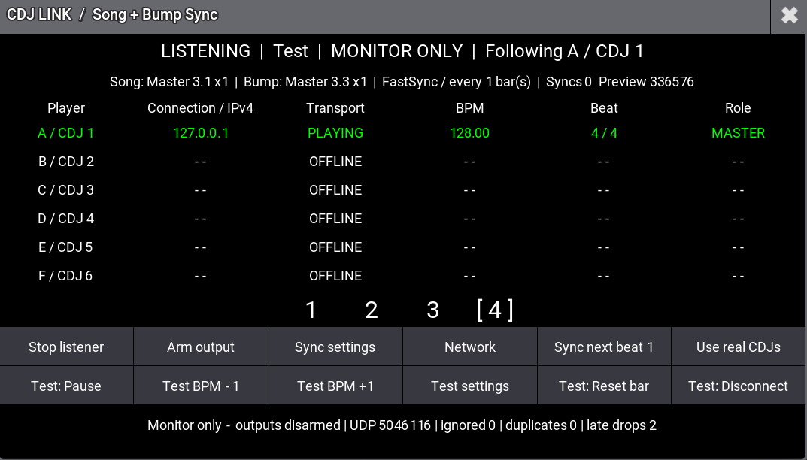

# grandMA3 PRO DJ LINK v1.0.0

Follow CDJ BPM and synchronize grandMA3 phasers on received musical downbeats, directly inside the console.

**Tested on a grandMA3 compact running 2.4.2.2 with four CDJ-3000 players. The maintainer reported that it worked perfectly after correcting a VLAN configuration issue.** Other hardware/software combinations have not been verified.

*Actual dashboard screenshot from the original CDJ LINK build: loopback **Test mode**, simulated player A, output disarmed. The released plugin is branded grandMA3 PRO DJ LINK.*

[View all four interface screenshots: dashboard, sync settings, master routing and network](https://github.com/Anon772000/grandma3-PRO-DJ-LINK/blob/v1.0.0/docs/screenshots.md).

## Included

- Native six-player dashboard with connection, transport, BPM, beat and master status.
- Fixed-player / tempo-master following.
- Two configurable speed-master channels with multipliers and enables.
- Downbeat-only FastSync/ReSync, configurable cadence, BPM-only mode and queued manual sync.
- Monitor mode, explicit Arm/Disarm, saved settings and loopback Test CDJ.
- Optional CDJ Stop All listener recovery utility.
- Installation, network, executor macro and troubleshooting guides; MIT licence.

## Download and install

Download **grandma3-pro-dj-link-v1.0.0.zip**, extract it and copy the **grandMA3** folder to the root of a USB drive. In grandMA3, edit an empty Plugin pool slot, tap **Import**, select USB and import **grandma3-pro-dj-link.xml**.

The separate **grandma3-pro-dj-link.xml** asset embeds the Lua code and is sufficient for importing the main plugin. **cdj-stop-all.xml** is optional and belongs in a separate empty slot. **SHA256SUMS.txt** provides download checksums.

Default destinations are **Song → Master 3.1** and **Bump → Master 3.3**. Configure the DJ network and confirm player reception while disarmed, then choose your routing and arm output. Run one listener. Closing its window leaves reception running; **Stop listener** releases its sockets.

Documentation: [README](https://github.com/Anon772000/grandma3-PRO-DJ-LINK#readme) · [Network setup](https://github.com/Anon772000/grandma3-PRO-DJ-LINK/blob/main/docs/network-setup.md) · [Executor control](https://github.com/Anon772000/grandma3-PRO-DJ-LINK/blob/main/docs/executor-buttons.md).

## Validation

18 automated Lua regressions pass. Distribution XML embedding, ZIP integrity and checksums are verified. Native onPC development checks included FastSync/ReSync acceptance, master BPM readback, pause/disconnect gating and independent loopback master handoff. These are distinct from the maintainer's four-CDJ hardware test.

The packet/timing engine is unchanged from the tested plugin. The dashboard name and distribution packaging have been updated for publication. Existing `CDJ Link Sync` settings remain compatible.
