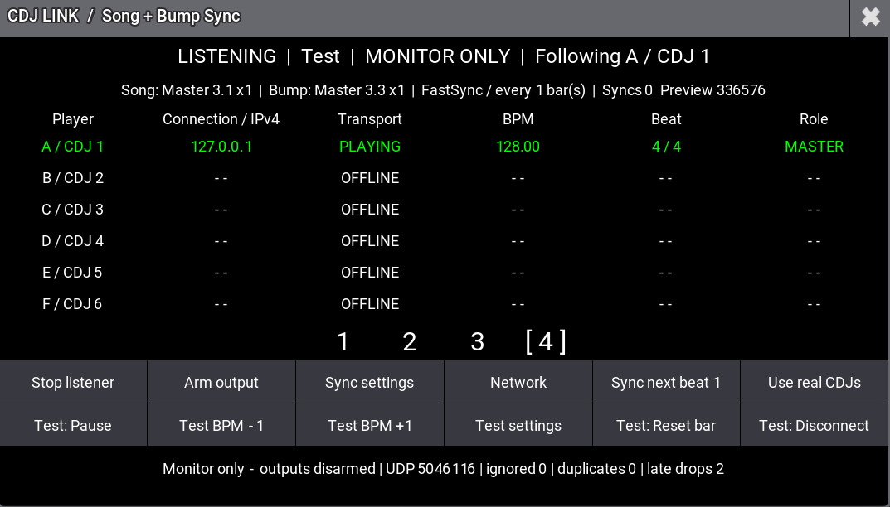
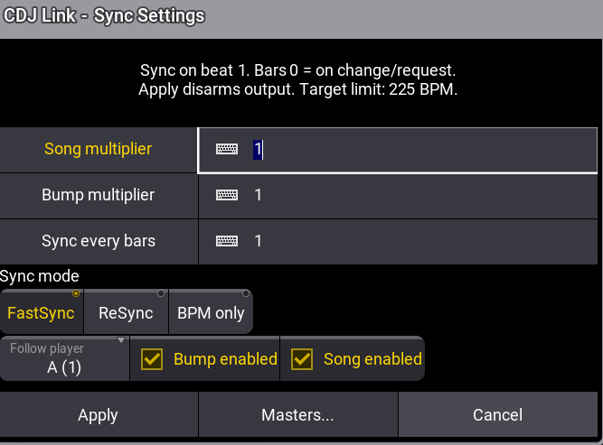
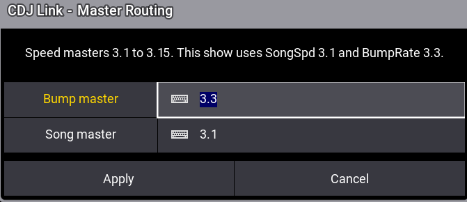
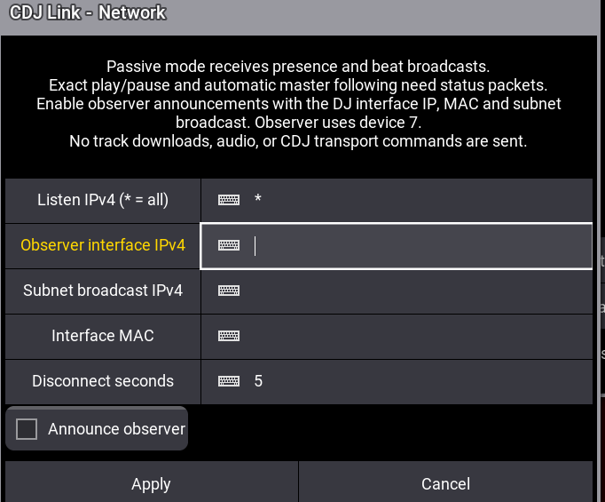

# Interface screenshots

Actual grandMA3 captures from the original CDJ LINK build. The public release uses the **grandMA3 PRO DJ LINK** name; its controls are the same. The dashboard image is a **loopback Test CDJ**, separate from the maintainer's four-player hardware test report.

## Dashboard



Player A / CDJ 1 is a simulated player at 128 BPM. Song is routed to Master 3.1, Bump to Master 3.3, both at ×1, with FastSync every bar. **MONITOR ONLY** confirms that the outputs are disarmed.

## Sync settings



Choose the source player or tempo master, sync mode, bar interval, enabled channels and multipliers. Applying settings disarms output.

## Master routing



Select the destination speed masters used by your phasers. The defaults shown are Song 3.1 and Bump 3.3.

## Network



The capture shows the default passive configuration. For detailed status and automatic master following, enter your own DJ interface IP, broadcast and MAC and enable observer announcements. See [network setup](network-setup.md).

## Taking more captures

Use real captures from grandMA3 2.4.2.2. A loopback demonstration should be captioned **Test mode / simulated player** so it is not mistaken for the four-deck hardware test.

Recommended captures:

1. **Dashboard:** connected players, IP/transport/BPM/beat columns, with output state visible.
2. **Sync settings:** selected player, FastSync/ReSync mode, interval and multipliers.
3. **Network settings:** the observer fields. Remove private network values before publishing if needed.

Press **F11** or **Print Screen** in grandMA3. With a USB drive selected, captures are stored in:

```text
grandMA3/gma3_library/media/images/
```

MA's generated filenames use `YYYYMMDD_hhmmss_displayX.png`. Copy captures to `docs/images/`, use descriptive names such as `dashboard.png` and `sync-settings.png`, and link them in the README with accurate captions. See [MA's screenshot instructions](https://help.malighting.com/grandMA3/2.4/HTML/screenshot.html).
