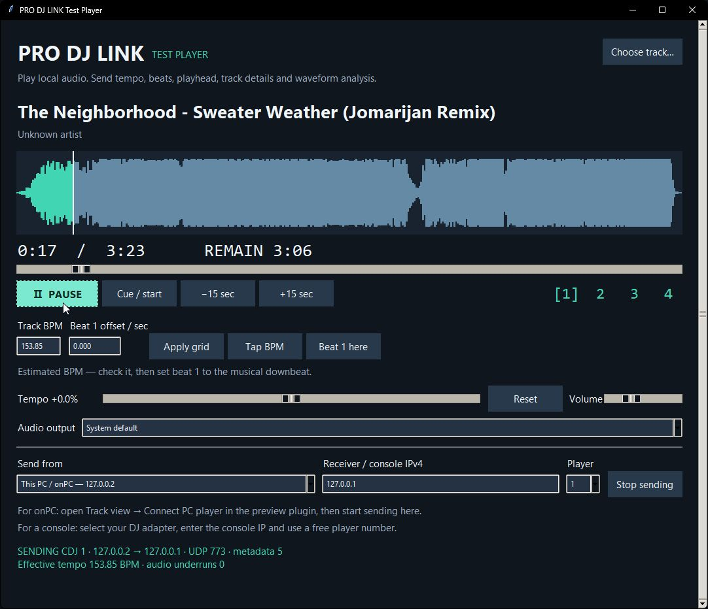

# PRO DJ LINK Test Player — Windows preview

A standalone audio player for testing grandMA3 PRO DJ LINK's experimental track display. Choose a local MP3, WAV, FLAC, OGG or AIFF file and hear it while the player sends beats, BPM, play/pause, master status and precise track position. It also answers the plugin's title, artist and waveform requests. No firmware or CDJ emulator is needed.



The packaged Windows application was observed playing a local MP3, sending packets with zero reported audio underruns, and serving metadata and waveforms to grandMA3 onPC 2.4.2.2. The matching native track display is shown in the [track preview guide](track-display.md). This confirms the local test path; physical-console simulator operation is still pending.

## Start on this PC

1. Extract the complete Windows ZIP and run **PRO DJ LINK Test Player.exe**. Keep its `_internal` folder alongside the executable. Python is included; you do not need to install it.
2. Choose a track, or open the included original **Demo-128-BPM.wav**. Choose an audio output if System default is unsuitable. Play/pause also responds to Space when you are outside a text field.
3. Import the included **grandma3-pro-dj-link-track-preview.xml** (v1.2.0-alpha.2) into an empty MA Plugin pool slot, stopping the previous listener first. Open **Track view → Connect PC player**. This selects Live input on `127.0.0.1`, enables track downloads and starts listening with MA output disarmed. Alternatively run `Plugin 8 "simulator"`, replacing 8 with your slot.
4. Leave the player's **Send from** as **This PC / onPC — 127.0.0.2**, receiver **127.0.0.1**, and player **1**. Click **Start sending**, then Play. The two loopback addresses let both programs share one PC without competing for the same sockets.
5. Check title, waveform, remaining time, play/pause, seeking and tempo changes. MA output stays disarmed until you arm it in the plugin.

Network sending is off at startup. Stop sending releases its sockets; closing the app stops playback and networking. It sends no audio files over the network.

## Beat grid

File tags supply title, artist and BPM when present. Otherwise the title comes from the filename, artist is **Unknown artist**, and a simple BPM estimate is shown. An estimate can be half/double time or inaccurate. Check it before judging phaser timing.

Enter the correct **Track BPM**, seek to a musical downbeat, and press **Beat 1 here**. Fine-tune **Beat 1 offset / sec** and **Apply grid** if necessary. **Tap BPM** helps measure tempo. The original generated demo is 128 BPM with beat 1 at 0.000 seconds. Grid settings last for the current loaded track; a different file resets them.

The tempo slider changes playback speed and outgoing effective BPM together, within ±16%. It also changes pitch; key lock and automatic variable-tempo grids are not implemented. Volume affects local audio only. The waveform is amplitude analysis in a single colour, rather than a rekordbox RGB frequency analysis.

## Send to a physical console

1. Put the PC's DJ adapter and console port on the same reachable subnet/VLAN. Select that adapter in **Send from** and enter the **console's IP** as receiver. Choose a free player number 1–6.
2. In the plugin select the console's DJ interface and enable **Announce observer**, **Fetch track metadata** and **Download waveforms**. Use Live input. Do not use Connect PC player for an external console: that shortcut selects loopback.
3. Start sending and verify reception disarmed. The player unicasts UDP 50000, 50001 and 50002 to the receiver. The plugin connects back to the selected PC IP on TCP 12523 and the database port returned by it. Existing network permissions must allow those connections.

This implements the subset used by this plugin, not a complete Pioneer/AlphaTheta player. Deck discovery by third-party DJ software, loading tracks from another deck, NFS media sharing, artwork, hot cues, loops and rekordbox analysis import are not implemented. Timing follows the local audio output clock; Windows scheduling and device latency still apply. Physical-console operation of this new simulator remains unverified.

## Build from source

Use Python 3.10 or later:

```text
python -m pip install -r simulator/requirements.txt
python tools/cdj-simulator.py
```

On Windows, install PyInstaller 6.22.3 into the same environment, then:

```text
python tools/build-simulator.py --output D:/PRO-DJ-LINK-Test-Player
```

The build writes an application folder, a ZIP with the original generated demo and dependency notices, and a SHA256 checksum. It does not bundle other music placed beside the build directory. The application source is MIT licensed; bundled dependencies retain their respective licenses.
